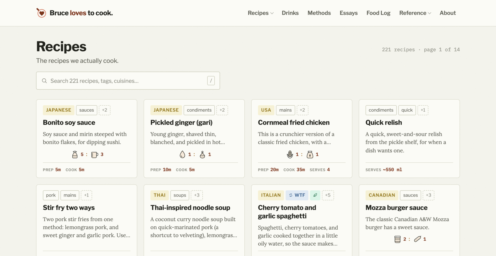

My cookbook is live. [Bruce loves to cook](https://bruce-loves-to-cook.ca/) has 229 recipes (221 dishes and 8 drinks), 18 essays, 15 reference pages, and a food log of 38 entries. Under them sit the methods: 5 standalone methods (pan sauces, stock, ratios, foil packets, and reverse searing), plus 5 blueprints (burgers, chicken sandwiches, poke, one-pan pasta, and muesli) broken into 21 parts and 26 builds. All of it is Markdown files, and Hugo turns it into 597 pages in about a second.

I meant to move some recipes out of Google Docs. Instead I built methods, blueprints, and burger builds, things no simple cookbook needs, and somewhere in the middle of it I remembered why I keep a cookbook at all.

<!-- #todo In your words: a sharper opening line or scene (the moment you looked up and the "simple" cookbook had blueprints) -->

## Decades of paper, then Google Docs

My recipes started on paper, in flour-dusted binders, and in a scatter of Word documents. Pulling them into one place started a long time ago and went slowly, a few recipes at a time, whenever I remembered.

<!-- #todo In your words: what the paper era looked like (binders, cards, a box, your parents' recipes?) and roughly when you started gathering them -->

Lockdown gave the project time. The recipes landed in Google Docs, which were pretty good: searchable, shared, and on every device. They were also very manual. Every recipe was formatted by hand, and every fix to the layout was a fix to every document.

Oddly, sharing was where Google Docs caused the most friction. A recipe I wanted to send someone was a document with permissions, not a link anyone could open and read.

<!-- #todo In your words: a sharing story, e.g. sending a recipe to a friend or family member and what went wrong (roles, not names) -->

It was also a pain to edit without a good network connection, which is often exactly when I want to fix a recipe.

<!-- #todo In your words: where you edit recipes without a network (so the line can name it) -->

And it never felt like a *thing*. It was a whole cookbook, hundreds of recipes, and it still read like a folder of files.

Along the way I tried the apps. Paprika and a handful of other iOS and Mac recipe managers were good at the parts they cared about, and they failed me on everything else. Export was awkward. Sync was fragile. The recipes lived in each app's own format, on each app's own hosting, and the layouts were whatever the app decided a recipe looked like.

<!-- #todo In your words: one concrete app story (an export that mangled things, a sync that lost edits, a layout that couldn't show a ratio) -->

This summer I started moving the Google Docs into Markdown. Then I tried Hugo for it, mostly because this blog already ran on Hugo. Hugo worked well here, but I hadn't automated much of the tooling around it yet, and the cookbook became the place I did.

The rule that drove the project came out of that move, and I wrote about it in [What I'm about, in plain text](/blog/2026/what-im-about-in-plain-text/):

> *A recipe should look **natural** in any text editor.*

There was a second half I didn't say out loud then: *and it should look great published.* Not an unstructured mess of headings and bullets, but a cookbook, with layouts and diagrams, that's easy to extend.

## Text with a bit of lipstick

Markdown is text with a bit of lipstick. It reads fine raw, and with a little help it can look like anything.

Here's an excerpt of my Asian slaw dressing, first as I write it, then as the site shows it.

`````tabs {layout="stack"}
tab: Text
````markdown
---
title: Asian slaw dressing
tags: [salads, quick, vegan, dairy-free, dressings]
servings: 6–8 (makes ~200 ml)
prep_time: 5 min
cuisine: Asian
---

## Mechanic

A **weight-based emulsified dressing** at 2:1 oil to acid.

```formula
oil       | Oil  | 2
: vinegar | Acid | 1
caption: By weight
bar: yes
```

## Ingredients

- 90 g extra-virgin olive oil, or a lighter neutral oil
- 45–50 g rice vinegar
- 30 g Dijon mustard
````

tab: On the site

`````

The front matter is ordinary YAML: tags, servings, times, and cuisine. The `## Mechanic` section is the idea behind the recipe, here a 2:1 ratio of oil to acid by weight, and the `formula` block under it is a diagram written as text. On the site, the Mechanic moves into the sidebar and draws as a bottle and a flask with a bar under them. The ingredients become a checklist you can tick off while cooking, with scaling and a metric/imperial switch.

None of that is in the text. The text stays a recipe you could print, paste into an email, or read in any editor.

The repo is my Obsidian vault, too. There's no CMS and no copy step: I edit a recipe where I keep my notes, and the next build publishes it.

<!-- #todo In your words: what writing a recipe looks like now (Obsidian on the counter, phone at the store, a quick fix after dinner) -->

## Scope creep, on purpose

The site went together quickly. Too quickly, maybe, because once the basic recipe pages worked, I started seeing what else plain text could do, and the scope exploded.

I added *methods*: pages that explain how a kind of food works, which variables matter, and how it fails, so you can cook something that isn't written down anywhere. Pan sauces. Stock. Reverse searing and water frying. Foil packets. A page of food ratios for making your own recipes.

Then *blueprints*, which break one kind of food into its parts, each with its own method, and the *builds* that combine them. Burgers got patties, seasoning, sauces, cooking, and assembly as parts, and then builds: a Whopper, a Teen Burger, a Mozza Burger, a smash burger, a pub burger, and my own. Chicken sandwiches got the same treatment, and so did poke, one-pan pasta, and muesli.

None of this is necessary for a simple cookbook. But these are the families of technique that actually drive my cooking. A recipe is one way through a pattern, and the patterns are what I actually cook from.

<!-- #todo In your words: an example of cooking from a pattern rather than a recipe (a pan sauce on a weeknight, a stock from scraps) -->

The burgers are the clearest example. I've been chasing my favourite burger for more than 20 years, and a burger is a stack of decisions: the bun, the sauce, the patty, and what goes where. Here's [the Bruce burger](https://bruce-loves-to-cook.ca/methods/burgers/builds/bruce-burger/), the one I make at home, as text and as the site draws it:

````tabs {layout="side"}
tab: Text
```stack
bun-top + mayo   | Toasted bun, mayo         | soft, rich
lettuce-shredded | Shredded lettuce          | cold crunch
tomato           | Thin tomato               | juicy, acid
mustard          | Mustard                   | sharp
pickle           | Double-sour pickles       | sour
onion-fried      | Onion sautéed in beef fat | sweet
patty-thin       | Thin patty, 140 g         | salt, fat, savoury
onion-raw        | Raw purple onion          | sharp
bun-base + mayo  | Toasted bun, mayo         | rich, barrier
```

tab: On the site

````

Each line is one layer: a part, what it is, and what it does for the bite. The site draws the stack from those lines and nothing else. That's the rule the diagram formats follow: *a diagram must not add anything the text doesn't say.* If the drawing knows something, the text has to say it first, so the text never loses anything when it's read raw.

It starts from the Whopper: one wide patty with everything cold stacked on top. The technique comes from the White Spot burger: a thin griddled patty, seasoned after it cooks. Every part is there because I tested the alternatives and they lost. Two onions, raw for sharpness and sautéed in the beef fat for sweetness. Double-sour pickles, the strongest sour on the burger. Mustard instead of ketchup, since the onions bring the sweetness now.

<!-- #todo In your words: the burger story, 20+ years of it (where it started, what changed, which test settled it); link [The quest for the perfect burger](https://bruce-loves-to-cook.ca/essays/cooking-reflections/the-quest-for-the-perfect-burger/) or retell a piece of it -->

Then chicken burgers. And stocks. And pan sauces. Wait a minute, I fucking love cooking.

I always have. I just needed to remind myself, and building the cookbook did that. The methods and blueprints weren't scope creep so much as me writing down how I actually think about food, for the first time, in a form I could keep.

Not everything is a method. Some of it is a principle, like [Win the fridge](https://bruce-loves-to-cook.ca/tags/win-the-fridge/): use every scrap before it goes to waste.

<!-- #todo In your words: one line on Win the fridge, why it matters to you (or cut to just the link) -->

## How it's built

The cookbook is three themes and a dialect.

```flow
Site theme   | branding
Recipe theme | recipe-ness
Base theme   | core services and sizing
caption: Where Hugo looks for a template, first to last
```

<!-- #todo In your words: maybe an aside here, that this is a lot like layering food (a digression, and a stretch; cut it if it stays one) -->

The site's config starts with one line:

```toml
theme = ["fugu", "blowfish"]
```

Hugo looks for each template in the site first, then in Fugu, then in Blowfish.

[Blowfish](https://blowfish.page/) is a decent base theme with some nice features, and it's scaffolding you rent. On day one it gave me search, dark mode, and RSS. Then I spent a day fighting it, and by the end I'd overridden 17 of its 141 templates.

<!-- #todo In your words: the day fighting Blowfish, what broke or what it insisted on -->

Fugu is the cookbook theme: recipe pages, the sidebar, ingredient checklists, methods, blueprints, and builds. It started inside the site and got split out once its boundary was obvious, which wasn't on day one. The site itself keeps only its branding: the logo, the colours, and the header.



The dialect is [hugo-warped](https://github.com/robotpony/hugo-warped): the diagram formats, each written down as plain text before it draws anything. Fugu imports it as a Hugo module, and this blog draws the same formats.

Hugo made this kind of extension easy. A template can take over any code fence by its name, so a new diagram format is a new template, and the text it reads stays plain. That's why the scope could blow up cheaply.

## No database

The cookbook has three layers of features, and no fourth: what's in the source, what happens at build time, and what happens in the browser. A backend for saved recipes came up and got deferred, because the moment there's a database, the text isn't the whole cookbook anymore.

<!-- #todo In your words: why deferring the backend felt right (or what would change your mind) -->

Structure comes from the files. Folders are for what a page can only be one of (a recipe, a method, a drink, an essay), and tags are for what it can be several of (vegan, quick, dressings). Wiki links resolve by title, so `[[Simple gravy]]` in Obsidian is a link on the site.

<!-- #todo check: the gravy title for the wiki link example -->

The build writes an `index.json` of the whole collection, which lets agents answer questions about it: which recipes use buttermilk, which methods have no builds yet, which tags are nearly empty.

That's the other reason plain text works so well here: it plays well with agents. They can read, review, and reshape hundreds of text files quickly, and they don't need an API to do it. Yes, I'm lazy. Agents also helped define how the text diagrams should work, and even came up with ideas for icons and glyphs.

<!-- #todo In your words: an example of an agent helping with a diagram format or an icon -->

A full build takes about a second for 597 pages.

Unfinished recipes are on the site too. A draft publishes as [Test kitchen](https://bruce-loves-to-cook.ca/reference/essays/test-kitchen/), on purpose; I wrote about why in the manifesto.

## Three things the agents taught me

I built most of the cookbook with Claude Code, over two to three weeks. A few things I learned stuck.

**Mocks are the decision log.** Before building a feature, I had the agent mock it up as a page I could look at. There are 31 mocks in the repo now, and each one ends with a dated *Decided* line saying what we picked. A later session, which remembers nothing, can open a mock and pick the decision up cold.

<!-- #todo In your words: one mock and the decision it captured (the sidebar Mechanic? the ingredient checklist?) -->

**Hooks enforce, memory guides.** I told the agent not to add itself as a co-author on commits. It remembered, mostly. The trailer slipped through on three commits anyway, until I added a hook that rejects any commit message carrying it. Memory is good for preferences. Anything that has to be true every time needs a hook.

<!-- #todo In your words: how you noticed the trailer, and how it felt -->

**Verify by looking.** An agent will tell you a page is done. Looking at it is how you find out it's maybe 50% there. The other half of that lesson was a Safari window nobody was watching.

<!-- #todo In your words: the "maybe 50% there" pass and the Safari window, the actual stories -->

<!-- #todo check: does this section overlap the "Building a recipe site with Claude Code" draft enough to cut that one, or does it stay separate? -->

## Take it

Everything is free. [Fugu](https://github.com/robotpony/hugo-theme-fugu) and [hugo-warped](https://github.com/robotpony/hugo-warped) are MIT licensed, for anyone to use or abuse. The recipes are [CC BY-SA](https://creativecommons.org/licenses/by-sa/4.0/), because recipes should be free, and mine are nothing special.

<!-- #todo check: is the not-a-chef repo itself public, and should it be linked here? -->

This isn't a tutorial, but if you want to build your own cookbook, here are the hints:

- **Two lines of config.** The `theme = ["fugu", "blowfish"]` line, and Fugu imports hugo-warped as a Hugo module on its own.
- **Small tools.** A few standard-library Python scripts keep the text honest: `frontmatter.py` reads and fixes front matter, and `check-fences.py` checks that every diagram block parses.
- **Slash commands.** One stubs a recipe (`/recipe-new`), others check the collection (`/lint`), open the dev server (`/preview`), and build and ship it (`/publish`).
- **A plain host.** The site is static files, rsynced to an ordinary web host.

It took two to three weeks of full-time work and cost under $25. It's only worth it if you want what I wanted: a printed-cookbook feel, today, from files you'll still be able to open in 20 years.

<!-- #todo check: what the under-$25 covered (agent usage, domain, hosting?) -->

## The text kept spreading

There's a trade-off. My wife still finds the old Google Drive cookbook easier to edit, and she's not wrong. When she adds a recipe there, I move it over by hand.

<!-- #todo In your words: her side of it, or a recipe of hers you moved over -->

The text kept spreading anyway. The diagram formats from the cookbook now draw diagrams on this blog and in Scorekeep, so this post's diagrams come from the cookbook's work. And as I was winding the cookbook down, the text-first thinking exploded into yet another project, [Space Command](https://space-command.ca/): plain text for to-dos, not a new idea, but my take on an exoskeletal version of it. More on that later.

<!-- #todo In your words: one line on what "exoskeletal" means for Space Command -->

Somehow a cookbook rekindled my love of cooking, of writing about it, and even of building blog-shaped things.

<!-- #todo In your words: the closing line -->
