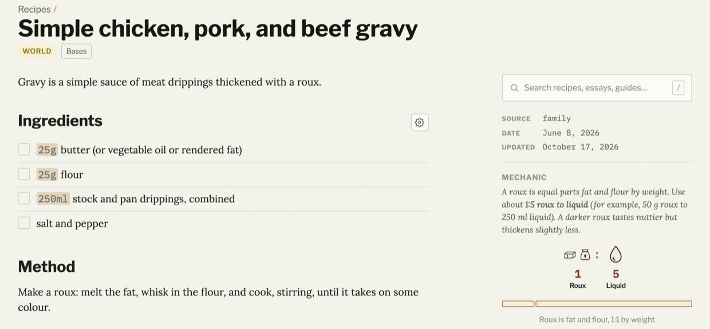

My first real computer was an Atari 600XL. I usually tell people it was an 800, so I don't have to explain the difference between models. With the 600XL I got a whopping 16 KB of RAM, a Centipede cartridge, and a previous-generation Atari 410 tape drive.

That tape drive was the bane of my childhood. It ate tapes, the sort of low-quality cassettes that a 10-year-old boy could afford, always purchased in 10-packs at Radio Shack. The most devastating loss was when the drive destroyed my last copy of a horizontal scroller I'd written, along with every sprite I'd drawn for it. From those experiences, I learned to save each program I wrote several times, on multiple tapes when I had spares. It was never enough.

I also learned to write designs in a notebook and sketch interfaces in detail. I even sketched fonts and sprites down to the bit level, so I could encode them in the bytes the machine expected.

That notebook survived when the tape didn't, and I'm still writing things down to this day. And thinking a design through by writing it down has stuck with me ever since.

## Searching for my spark

That boy had a fire in him that has haunted me all of my life. It's great when it's there, but it's frustrating and painful when it's not. Sometime in the last few years, that flame was dimmer than it's ever been, so I took some time off to enjoy the beautiful weather: long walks, the local beaches, and a lengthy Pacific Ocean vacation. And I found that spark again, all by remembering where I started.

I'm writing daily now, a strong signal that I'm excited about what I'm doing again. I rediscovered my inner coder and tinkerer, now backed by years of managing products, designs, and teams of people building them. These days I don't need the huge teams of years past, but the principles are the same. And it's great to find that inspiration again; I just had to remember who I am.

And who am I?

1. *I'm a writer. I love words and text.*
2. *I make software.*
3. *I tinker. I make art, I cook, I make music.*
4. *And I teach.*

In my time off, I tinkered and built things. Looking back, I found some clear patterns. Each project served its own purpose and had its own shape, but they were all stitched together with the same handful of threads: writing, publishing, and terminal tools, each driven and defined by text. And in this exploration, I felt that feeling again. *I was excited.*

This is my attempt to capture some of the principles I found, mostly so I can check myself and my next projects against them. Nearly all of it comes down to writing things down and thinking about them, because machines forget, and so do I.

## I'm a writer

### Plain text is the foundation

Almost everything I make starts, and ends up, as Markdown these days. Designs, specifications, recipes, tasks, blog posts, game briefs, comics, and even interactive fiction. Markdown is a form of structured plain text: it has no API, no auth, and requires no special SDK. It opens in any text editor, it diffs nicely in git, and it will be readable long after today's tools are gone.

**Text reads naturally**. Building my cookbook ([Bruce loves to cook](https://bruce-loves-to-cook.ca/)) changed how I develop recipes. They moved from paper to Google Docs to Hugo and Markdown, and the site now builds a well-shaped recipe book, including diagrams drawn from plain ASCII text.

The rule that drove the cookbook project was simple:

> *A recipe should look **natural** in any text editor.*

For example, here's a short version of my [simple gravy](https://bruce-loves-to-cook.ca/recipes/simple-chicken-pork-and-beef-gravy/) recipe, as text and as the site shows it:



````markdown
## Mechanic

A roux is equal parts fat and flour by weight. Use about **1:5 roux
to liquid** (for example, 50 g roux to 250 ml liquid). A darker roux
tastes nuttier but thickens slightly less.

```formula
butter flour | Roux   | 1
: water      | Liquid | 5
caption: Roux is fat and flour, 1:1 by weight
bar: yes
```

## Ingredients

- 25 g butter (or vegetable oil or rendered fat)
- 25 g flour
- 250 ml stock and pan drippings, combined
````






Pages read well as plain text. They also need to work well in Obsidian and Hugo, and still be easy to [automate with simple tools](https://bruce-loves-to-cook.ca/).

**Text, specifically my text, is sacred**. [Space Command](https://space-command.ca/) is a macOS app that finds the `PLAN.md` files and `#todo`, `#idea`, and `#focus` tags in my notes, and manages them. The source of truth is my text files, not a database I can't see. It's a nerd's tool, but it fits my neurospicy brain nicely.

Here's a mock sample plan, modelled on how I developed that cookbook:



```markdown
## Drafting

- [x] Chapter 1 · Flour
- [x] Chapter 2 · Water and salt
- [ ] Chapter 3 · Starters
- [x] Chapter 4 · Mixing and folding
- [x] Chapter 5 · The first rise
- [x] Chapter 6 · Shaping
- [x] Chapter 7 · Proofing in the fridge
- [ ] Chapter 8 · Baking in a Dutch oven #focus
- [ ] Chapter 9 · When it goes wrong
```






**Text defines the world**. [Thwarter](https://github.com/robotpony/thwarter), my interactive fiction engine, builds stories from Markdown and front matter, the same way Hugo builds a site.

**Long live text**. My blogs and comics live in text, and so does every repo. It's the most durable format I know.

### Text defined my journey

A programmer who loves text isn't unusual. We work in it daily. What's special is that for some of us it becomes part of how our brains work.

My love of text started a long time ago, but two things stand out:

1. [John Carmack's `.plan` files](https://github.com/oliverbenns/john-carmack-plan)
2. Mike Gancarz's [*The UNIX Philosophy*](https://www.goodreads.com/en/book/show/633070.The_UNIX_Philosophy)

These cemented the principles I was already discovering. Seeing others use text to define everything, including raw design thinking, rewired how I built things. So did the idea that text is universal, and can be *piped* from tool to tool.

Text is more than just programming. I've run this weblog for almost 30 years, and it's lived in dozens of tools and formats. And the durable ones, the really durable ones, were all based in plain text. I started with hand-coded HTML, and I tried tool after tool until I found what I really loved.

I especially loved [Blosxom](http://www.blosxom.com/), the first blogging tool I used that kept posts as simple files. John Gruber released *Markdown* in 2004 as a plugin for Blosxom and Movable Type, and I started writing my posts in it. After that, I ran Warped on WordPress for years, since I'd used it for client work. I was always fighting its web UI for my personal sites, as I couldn't `grep` or see my posts locally. Then I remembered seeing [*Hugo*](https://gohugo.io/), and I made the switch. Apart from one more detour, Hugo has been home since.

Enter the world of LLMs. Text is king again. AI agents read and write plain text natively, so my notes, plans, and specs double as their working context, with no export or API in between. I've moved all of my notes and thinking back into text.

```timeline
1980 The school's one computer
1983 Atari BASIC
1995 *The UNIX Philosophy*
1996 WarpedVisions, a link log
1996 Carmack's `.plan` files
2002 Blosxom
2004 Markdown
~2008 WordPress, a detour
~2015 Hugo, first look
2022 Write.as
2024 Hugo, for good
2025 *Claude and LLMs, text reborn*
```

### Writing is how I think

For that boy, saving extra copies helped. Well, some of the time at least. A chewed tape could be cut and reattached to its spindle, and a copy on a second tape was safer still. But the cheap tapes and that drive always failed eventually, so I reimplemented most games several times. I wrote dozens of games, tools, and curios, all of them lost to time.

Somewhere along the way the notes stopped being a backup and became how I figure out what to build. I use the same pattern now, except that source control has replaced the extra copies. I always write out the design, and I always mock up user and programmatic interfaces.

My current projects use text files as that notebook again. I keep `PLAN.md` and various `DESIGN.md` files at the core of most work. An AI tool forgets everything between sessions, not too different from the way the tape forgot my games, so I write the design down first and those agents rebuild their context from there. It's a similar lesson, about 40 years later.

```flow
row: 1983
Tape | eats the game
Notebook | the design
Rebuild
row: 2026
Session | forgets everything
`PLAN.md` | the design
Rebuild
caption: Both machines forget; the notes don't
```

## I make software

I create software, and these days most of it is small. [dailyweather](https://github.com/robotpony/dailyweather) prints the forecast from Environment Canada's feeds, and [ftree](https://github.com/robotpony/ftree) reads genealogy files in the terminal. Each does one thing and speaks text, so they're easy to script, pipe, and hand to an agent. That's Gancarz's book again, three decades on.

Even Space Command, the biggest thing I built this year, is a small tool at heart: it reads my text files and gets out of the way.

### Unfinished work is worth showing

Research is just the work shown before it's finished. I try several versions, compare them honestly, and write down why: [batches of recipes side by side](https://bruce-loves-to-cook.ca/essays/technique-essays/how-to-find-great-recipes/) to find the best one. I take careful notes on Environment Canada's feeds for [dailyweather](https://github.com/robotpony/dailyweather), and I developed four visual treatments for Scorekeep, a scorekeeping pad for real-world games based on keeping score on paper, before choosing one. And the [50+ mocks](https://space-command.ca/mocks/) in Space Command led to something I really like.

Showing the work keeps me accountable, and it's useful for teaching. The game jam's weekly posts meant there was always something to show, so I kept shipping. It also makes the work transparent to agents, which can reference a source of truth that I've developed and tested.

Text can be useful to normal people too. It can drive publishing and teaching tools, and can be automated to replace a lot of what designers, artists, and typesetters used to do by hand.

Cookbooks are a great example. The typical way to write a cookbook is to hide the work. Following Carmack's `.plan` file approach of writing about design, I decided that I would rather not hide the design and development of recipes. Recipes that aren't finished are marked [*Test kitchen*](https://bruce-loves-to-cook.ca/reference/essays/test-kitchen/), and they're published on purpose. To me, a recipe is closer to source code than scripture: it has versions, bugs, and fixes.

I have a theory that good practice doesn't change with the tools, so writing things down, being transparent, and publishing regularly fit together. The same principle cuts the other way, too, and a lot of the ways people use LLMs fail that test. Vibe coding a whole app from a single prompt is the silliest. There's no design written down, nothing to check the result against, and nothing to rebuild from. The test makes a good filter: if it isn't good practice without an LLM, it isn't good practice with one.

## I tinker

### Craft is found by playing

From my game-making principles: *be emotive, be funny, be fun. Lean into constraints, limits, and plot holes.* Those read well on paper, but I only learned what they mean by playtesting.

I wrote a tiny space game, [Gyri #4](https://jams.warpedvisions.org/), a Gyruss-style shooter where the ship and enemies move along concentric arcs, and I kept iterating on it. It only became fun once I added variation and particle effects. It's been a long time since I was able to play in code like that. What made it work was keeping playtesting and engineering logs, and reflecting on them regularly.

Play is how I find what's fun; craft is how I get it to fit. I believe simplicity is possible in anything, where simple means things fit _just so_. It's [a kitchen you know by heart](/blog/2025/the-comfort-of-home-bases-for-creative-work/), where you stop thinking about the tools and think about the food. It's an instrument that becomes part of your fingers. And it's where I do my best work.

We become who we are inch by inch, failure by failure, and craft works the same way. It's fit and finish, done in small steps: a game tuned one playtest at a time, a recipe that stays in the test kitchen until it earns its way out, a heading nudged closer to the paragraph it belongs to, a commit that does one thing. Text makes those steps cheap, and git keeps every one of them, so I can afford to fail a lot on the way to _just so_.

## And I teach

### Teaching starts with writing

Most of the things I've learned started with reading. Personal computing was still newish for my generation, and I learned about it through magazines and textbooks. I read everything I could, even if I didn't have the history or math to understand it. And it's still the first place I go to learn about something.

Text is core to learning, and it's a fundamental part of teaching.

I like to say that *"I like to teach, I think,"* because I'm not always certain of it. I'm occasionally impatient, and it's easy to forget how I came to understand something. To teach something, you need to remember the path you took to learn it, and those darned paths change with each generation of tools and humans. But I do like to teach, *I think*.

I remember helping a number of people learn SQL. SQL is a dense, terse language for asking questions about structured data. It's efficient when used properly, which requires some math-y thinking, some knowledge of history, and a bunch of experience. I've always struggled to teach SQL to beginners, and JOINs were the hardest part.

When I finally wrote it down, I explained JOINs with Venn diagrams, somewhat incorrectly. Even so, the page showed me the gap: I'd never thought deeply enough about JOINs, or planned how to teach them. When I tried to teach it live, I'd forget my own path; writing it down is how I found it again. And writing things down is how I found myself again, too.

Now my approach to teaching is to write first. Once I've written it, I can iterate and teach more effectively, but those lesson plans are where the real effort is. Well, that and keeping those lesson plans up to date where they fall short. And they will.

### Methods are key

The recipes are where this works best for me. I didn't start to grok cooking until I understood that methods were more important to learn than recipes. The French figured this out forever ago, and of course I had to rediscover it through chefs like [Kenji](https://kenjilopezalt.com/) and [Chef John](https://www.foodwishes.com/). Showing methods teaches people how to adapt, because recipes are rarely exact. Ingredients, humidity, equipment, and dietary needs all vary.

That's why the gravy recipe above leads with its Mechanic. Learn the 1:5 ratio and you can thicken whatever is in the pan, with or without the recipe.

## What's next

I found that spark again when I realized that the 10-year-old with a notebook beside his wonky tape drive and the person writing `PLAN.md` files were doing the same thing. Both of us write the design down first, because the machine will forget it one way or another. For that matter, so will the human. Both of us keep the notes somewhere they can be read and rebuilt from. I didn't set out to work this way, but over the years it won out.

So what's next is more of the same, on purpose. [Space Command](/blog/space-command/) is in alpha playtest now, and it's the most direct version of all this: an app whose source of truth is plain text. I'll keep writing about it here first, and I'll keep checking each new tool against the same filter: if it isn't good practice without an LLM, it isn't good practice with one.

If any of it sparks something for you, write about it on your own site or socials and link back.
