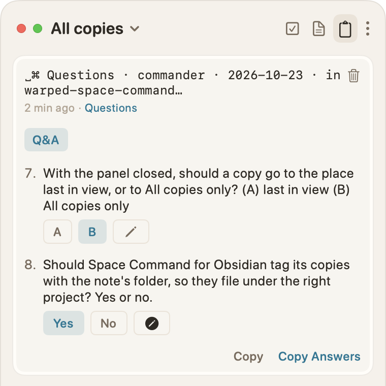

My first real computer was an Atari 600XL. I usually tell people it was an 800, so I don't have to explain the difference between models. With the 600XL I got a whopping 16 KB of RAM, a Centipede cartridge, and a previous-generation Atari 410 tape drive.

<!-- Length: about 3,100 words of prose, past the 3,000 ceiling for an essay. Cutting the repeats flagged below gets about 400 back. #todo -->

That tape drive was the bane of my childhood. It ate tapes, the sort of low-quality cassettes that a 10-year-old boy could afford, always purchased in 10-packs at Radio Shack. The most devastating loss was when the drive destroyed my last copy of a horizontal scroller I'd written, along with every sprite I'd drawn for it. From those experiences, I learned to save each program I wrote several times, on multiple tapes when I had spares. It was never enough.

I also learned to write designs in a notebook and sketch interfaces in detail. I even sketched fonts and sprites down to the bit level, so I could encode them in the bytes the machine expected.

That notebook survived when the tape didn't, and I'm still writing things down to this day. Unfortunately my notebooks haven't survived the 40 years since, but the way of thinking has always stuck with me.

<!-- Contradiction: "That notebook survived", then "my notebooks haven't survived". Maybe "The notebook outlasted the tapes." #todo -->

## Searching for my spark

That boy had a spark that has haunted me all of my life. It's great when it's there, but it's frustrating and painful when it's not. It was dimmer than normal this summer, so I took some time off and enjoyed the mild weather, long walks, exploring the local beaches, and a lengthy Pacific Ocean vacation. And I found that spark again by remembering where I started. 

<!-- The spark is set up here and never comes back. Pay it off in the closing. #todo -->

I'm writing again, which is one of the signs that I'm excited about what I'm doing. I've rediscovered my inner coder and tinkerer, now backed by years of managing products, designs, and teams of people building them. These days I don't need the huge teams of years past, but the principles are the same. And it's great to find that spark again; I just had to remember who I am.

<!-- "Remember who I am" appears here, in the paragraph above ("remembering where I started"), and after the project list. Keep one. #todo -->

And who am I?

1. *I'm a writer. I love words and text.*
2. *I make software.*
3. *I tinker. I make art, I cook, and I make music.*
4. *And I teach.*

I looked back at what I've built this year: 
- [an online cookbook](https://bruce-loves-to-cook.ca/) and [tools for making cookbooks](https://github.com/robotpony/hugo-theme-fugu) using Markdown and Hugo, 

<!-- "texty" appears twice in this list (Space Command and Thwarter). Drop one. #todo -->
- a nerdy, texty [TODO tool](https://space-command.ca), 
- a minimalist [scorekeeping app](https://scorekeep.warpedvisions.org) for scoring games played in real life, 
- a pile of Obsidian plugins,
- a summer [game jam](https://github.com/robotpony/game-jams) of [several fun little games](https://jams.warpedvisions.org), 
- a command-line [weather tool](https://github.com/robotpony/dailyweather), 
- an RFC for the obscure GEDCOM format (genealogy files) and some [terminal tools](https://github.com/robotpony/ftree),
- a texty [text adventure engine](https://github.com/robotpony/thwarter), started (again), 
- and a bunch of other [small](https://github.com/robotpony/peep) tools and curios. 

These projects all had different shapes but were all stitched together with the same handful of beliefs. Between doing and reflecting I remembered who I am. This is my attempt to capture some of the principles I found, mostly so I can check myself and my next projects against them. Nearly all of it comes down to writing things down and thinking about them, because machines forget, and so do I.

## Plain text is the foundation

Almost everything I make starts, and ends up, as Markdown these days. Designs, specifications, recipes, tasks, blog posts, game briefs, comics, and even interactive fiction. Markdown is a form of structured plain text: it has no API, no auth, and requires no special SDK. It opens in any text editor, it diffs nicely in git, and it will be readable long after today's tools are gone.

**Text reads naturally**. My not-a-chef project (now [♥︎ Bruce loves to cook](https://bruce-loves-to-cook.ca/)) transformed my cookbook and recipe development, which moved from paper to Google Docs to Hugo and Markdown. It builds a well-shaped recipe book, including diagrams drawn from plain ASCII text. 

The rule that drove the cookbook project was simple:

> *A recipe should look **natural** in any text editor.*

For example, here's part of my [simple gravy](https://bruce-loves-to-cook.ca/recipes/simple-chicken-pork-and-beef-gravy/) recipe, as text and as the site shows it:



````markdown
## Mechanic

A roux is equal parts fat and flour by weight. Use about **1:5 roux 
to liquid** (for example, 50 g roux to 250 ml liquid). A darker roux 
tastes nuttier but thickens slightly less.

```formula
butter flour | Roux   | 1
: water      | Liquid | 5
caption: Roux is fat and flour, 1:1 by weight
bar: yes
```

## Ingredients

- 25 g butter (or vegetable oil or rendered fat)
- 25 g flour
- 250 ml stock and pan drippings, combined
````






Pages must read well as plain text. They also need to work well in Obsidian and Hugo, and still be easy to [automate with simple tools](/blog/2026/not-a-chef/smart-content-on-plain-markdown/). Text is fast and easy, and it gets out of my way.

**Text, specifically my text, is sacred**. [Space Command](https://space-command.ca/) is a macOS app that finds the `PLAN.md` files and `#todo`, `#idea`, and `#focus` tags in my notes, and manages them. The source of truth is my text files, not a database I can't see. It's a nerd's tool, but it fits my neurospicy brain nicely.

<!-- The sourdough example below belongs right under this paragraph, before Thwarter and "Long live text"; then "Want another example?" can go. #todo -->

**Text defines the world**. [Thwarter](https://github.com/robotpony/thwarter), my interactive fiction engine, builds stories from Markdown and front matter, the same way Hugo builds a site.

**Long live text**. My blogs and comics live in text, and so does every repo. It's the most durable format I know.

**Want another example?** Here's part of a plan from Space Command's demo world, a sourdough book in progress, as text and as the app shows it:



```markdown
## Drafting

- [x] Chapter 1 · Flour
- [x] Chapter 2 · Water and salt
- [ ] Chapter 3 · Starters
- [x] Chapter 4 · Mixing and folding
- [x] Chapter 5 · The first rise
- [x] Chapter 6 · Shaping
- [x] Chapter 7 · Proofing in the fridge
- [ ] Chapter 8 · Baking in a Dutch oven #focus
- [ ] Chapter 9 · When it goes wrong
```






That's the whole format. Every checkbox in a `PLAN.md` is already a task, so it needs no tag, and `#focus` marks the chapter I'm on now. In any other note, a `#todo` at the end of a line does the same job. It reads fine in `vim`, VS Code, Obsidian, and even renders well on GitHub. Space Command slurps up all of those tasks and folds my finished work away so only what's left shows, `#focus` tag and all.

## Text is a key part of my history

<!-- Weakest heading in the post. Maybe "Text has always been home" or "I've been here before". #todo -->

My love of text started a long time ago, but the real inspiration started with [John Carmack's `.plan` files](https://github.com/oliverbenns/john-carmack-plan). Around that time I read Mike Gancarz's [*The UNIX Philosophy*](https://www.goodreads.com/en/book/show/633070.The_UNIX_Philosophy), which cemented the principles. I was already working in text, but these set the foundation in my mind. The idea that text could define everything, including raw design thinking, rewired how I built things. So did the idea that text is universal, and can be *piped* from tool to tool.

I even took the time to get comfortable in `vim`, something I've never regretted. It looked dated then and still does, but it leans on what text does well. I learned to stack piped commands and to write scripts in Perl, Python, `sed`, and Ruby.

I've run this weblog for almost 30 years, and it's lived in dozens of tools and formats. And the durable ones, the really durable ones, were all based in text. I started with hand-coded HTML, and I tried tool after tool until I found what I really loved.

One highlight was [Blosxom](http://www.blosxom.com/), the first blogging tool that kept posts as simple files I could search and script. Gruber first released *Markdown* in 2004 as a plugin for it and Movable Type. I built a few pale imitations of Blosxom after it went unmaintained. Then Warped ran on WordPress for years after that, as I'd used it for client work from its early days. I was always fighting its web UI for my personal sites, as I couldn't `grep` or see my posts locally. Then I remembered seeing [*Hugo*](https://gohugo.io/), and I made the switch. Apart from one more detour, it's been home since.

I learned that lesson again on [Write.as](https://write.as), the second detour. In 2022 I [moved the site there](/blog/2022/warped-v40/), which meant hand-importing 60 posts over about 10 hours of evenings and cleaning up the Markdown that 17 generations of WordPress and Pandoc left behind. In 2024 I [ported it back to Hugo](/blog/2024/warped-42-back-to-basics/) in about a day, and since then it's lived as plain text in a repo I own.

Enter the new world of LLMs. Text is king again. LLMs read and write plain text natively, so my notes, plans, and specs double as their working context, with no export or API in between. I've moved all of my notes and thinking back into text.

```timeline
1980 The school's one computer
1983 Atari BASIC
1995 *The UNIX Philosophy*
1996 WarpedVisions, a link log
1996 Carmack's `.plan` files
2002 Blosxom
~2008 WordPress, a detour
~2015 Hugo, first look
2022 Write.as
2024 Hugo, for good
2025 *Claude and LLMs, text reborn*
```


**My take**: Text is incremental, especially when paired with source control. Other tools have undo and history, but they're buried in menus, while `git log` and `diff` are one command away. And the commands are richer: you can see the reasons for changes, tag and branch to show progression, and remix easily. You never really lose changes. Yes, I realize the terminal is not great for all users, but for me it's home.

<!-- This is about git, not history. Move it to the end of "Plain text is the foundation", and drop or rename the "My take" label. #todo -->

**Where text falls short**: music, art, and photos don't live in text, though my notes about them do. I play piano from my own notes on chords and timing more often than from sheet music. And plain files can feel hostile to anyone who doesn't live in a terminal. Obsidian helps there, as a friendlier face on the same files, and Space Command is my attempt at another.

## I own the press

This site has been running for 30 years, on more engines than I can list (see [about the site](/pages/about-warpedvisions-dot-org/)). It's always been my testing ground. Today it's Hugo, my own custom theme, a few scripts, and rsync to publish it to the same host I've used for decades.

```flow
Text editor | edit
Markdown | in git
Claude | review
Hugo | build
rsync | to DreamHost
caption: Space Command watches the plans across all of it
```

Owning the press means I set the rules, and Warped [has no comments](/pages/about-warpedvisions-dot-org/) for good reason. Instead I encourage people to respond by writing something of their own. This, of course, raises the bar and prevents a lot of silliness.

<!-- No comments is said here, in "What I leave out", and in the closing ask. Two is enough. #todo -->

The pipeline matters to me. A writing tool I can't `grep`, or see locally, runs against the grain of how I think. It also means I publish here first, the IndieWeb idea of [POSSE](https://indieweb.org/POSSE): *publish on your own site first, and syndicate elsewhere.*

## Writing is how I think

Saving extra copies helped, sometimes. A chewed tape could be cut and reattached to its spindle, and a copy on a second tape was safer still. But the cheap tapes and that drive always failed eventually, so I reimplemented most games several times. I wrote dozens of games, tools, and curios, all of them lost to time.

<!-- Orphaned from the intro: this picks up the tape story mid-thought. Move it back after the intro's tape paragraph, or open this section on the notebook. #todo -->

Somewhere along the way the notes stopped being a backup and became how I figure out what to build. I use the same pattern now, except that source control has replaced the extra copies. I always write down the design, and I always mock up user and programmatic interfaces.

My projects' text files are that notebook again, with `PLAN.md` and `DESIGN.md` at the core. An AI tool forgets everything between sessions, the way the tape forgot my games, so I write the design down first and it rebuilds from there. It's the same lesson, about 40 years later.

```flow
row: 1983
Tape | eats the game
Notebook | the design
Rebuild
row: 2026
Session | forgets everything
`PLAN.md` | the design
Rebuild
caption: Both machines forget; the notes don't
```

When an agent needs a decision from me, it copies its questions to the clipboard as plain text, numbered, with the answers it expects, under a header line that names the session and project. Space Command's Clipboard tab picks them up:



```text
␣⌘ Questions · commander · 2026-10-23 · in warped-space-command

7. With the panel closed, should a copy go to
   the place last in view, or to All copies
   only? (A) last in view (B) All copies only
8. Should Space Command for Obsidian tag its
   copies with the note's folder, so they file
   under the right project? Yes or no.
```






<!-- Readers may wonder why the questions start at 7. Renumber to 1 and 2, or say they're from a longer list. #todo -->

## Unfinished work is worth showing

The usual way to write a cookbook is to hide the work. Being me, I'd rather not hide the design and development of recipes. The bruce-loves-to-cook recipes that aren't finished are marked [*Test kitchen*](https://bruce-loves-to-cook.ca/reference/essays/test-kitchen/), and they're published on purpose. A recipe is closer to source code than scripture: it has versions, bugs, and fixes.

This idea falls out of how we build software:

[**Game jam rule 4**](https://github.com/robotpony/game-jams#rules): post your updates online weekly, including game specs, and prompts if used.

**Repos carry their plans**, bug lists, and decision logs in the open.

**Don't hide the tooling**. Working with AI is part of the work, so the prompts and `CLAUDE.md` files get shown too. This helps you remember, and can help teach others.

Research is the work shown before it's finished. I try several versions, compare them honestly, and write down why: [batches of recipes side by side](https://bruce-loves-to-cook.ca/essays/technique-essays/how-to-find-great-recipes/) to find the best one. I take careful notes on Environment Canada's feeds for [dailyweather](https://github.com/robotpony/dailyweather), and I developed four visual treatments for Scorekeep before choosing one. And the [50+ mocks](https://space-command.ca/mocks/) in Space Command led to something I really like.

Showing the work keeps me accountable. The game jam's weekly posts meant there was always something to show, so I kept shipping. It also makes the work transparent to agents, which can reference a source of truth that I've developed and tested.

I have a theory that good practices are always good practices, so writing things down, being transparent, and publishing regularly fit together. The reverse holds too: a lot of the ways people use LLMs fail that test. Vibe coding a whole app from a single prompt is the silliest. There's no design written down, nothing to check the result against, and nothing to rebuild from. The test makes a good filter: if it isn't good practice without an LLM, it isn't good practice with one.

<!-- "The reverse holds too" isn't a reverse; try "The same test cuts the other way:". The filter line is repeated in the closing; keep that one and trim it here. #todo -->

## Craft is found by playing

From my game-making principles: *be emotive, be funny, be fun. Lean into constraints, limits, and plot holes.* Those read well on paper, but I only learned what they mean by playtesting.

I wrote a space game, [Gyri #4](https://jams.warpedvisions.org/), a Gyruss-style shooter (a Galaga descendant) where the ship and enemies move along concentric arcs, and I kept iterating on it. It only became fun once I added variation and particle effects. It's been a long time since I was able to play in code like that. What made it work was keeping playtesting and engineering logs, and reflecting on them daily.

I had the last two summers off, and the rest of what I made worked that way too: play first, then tune it until it's fun. A few of them:

- [The summer game jam](https://github.com/robotpony/game-jams): four weeks [rebuilding games](/blog/2025/the-feels-of-nostalgia-can-drive-great-design/) I played and wrote between 1980 and 1985, on [PICO-8](/blog/2022/playing-with-the-pico-8-fantasy-console/), Picotron, TIC-80, and pygame.
- [Retro desktop demos](https://github.com/robotpony/retro-demos), LED displays, a CD player nobody needs.
- Scorekeep's goal: *"it should feel like what it is: paper."* Buttery smooth over feature-complete.
- From my notes on toy software: *"Things that teach. Things that make you smile."*

Play is how I find what's fun; craft is how I get it to fit. I believe simplicity is possible in anything, where simple means things fit _just so_. It's [a kitchen you know by heart](/blog/2025/the-comfort-of-home-bases-for-creative-work/), where you stop thinking about the tools and think about the food. It's an instrument that becomes part of your fingers. And it's where I do my best work.

We become who we are inch by inch, failure by failure, and craft works the same way. It's fit and finish, done in small steps: a game tuned one playtest at a time, a recipe that stays in the test kitchen until it earns its way out, a heading nudged closer to the paragraph it belongs to, a commit that does one thing. Text makes those steps cheap, and git keeps every one of them, so I can afford to fail a lot on the way to _just so_.

## Teaching starts with writing

Everything I've learned started with reading. Personal computing was still newish for my generation, and I learned about it through magazines and textbooks. I read everything I could, even if I didn't have the history or math to understand it. And it's still the first place I go to learn about something.

<!-- "Everything" overclaims; the craft section says you learn by playing. Maybe "Most of what I know". Name a magazine or two for specificity. #todo -->

Text is core to learning, and clearly it's a fundamental part of teaching.

<!-- "clearly" is filler, and the line restates the paragraph above. Cut or fold in. #todo -->

I like to say that *"I like to teach, I think,"* because I'm not always certain of it. I'm occasionally impatient, and it's easy to forget how I came to understand something. To teach something, you need to remember the path you took to learn it, and those darned paths change with each generation of tools and humans. But I do like to teach, *I think*.

I remember helping a number of people learn SQL. SQL is a powerfully dense and obscure language for asking questions about structured data. It's efficient when used properly, which requires some math-y thinking, some knowledge of history, and a bunch of experience. I've always struggled to teach SQL to beginners, and JOINs were the hardest part.

<!-- SQL is everywhere, so it isn't obscure. Maybe "terse". #todo -->

When I finally wrote it down, I explained JOINs with Venn diagrams, somewhat incorrectly. Even so, the page showed me the gap: I'd never thought deeply enough about JOINs, or planned how to teach them. When I tried to teach it live, I'd forget my own path; writing it down is how I found it again.

<!-- Needs a payoff: what did the better explanation look like? A short before/after (Venn diagram vs. matching rows) would show it. #todo -->

My approach to teaching is to write first. When I write, I can be frustrated and not influence anyone negatively. I just put that frustration back into my writing and redraft. Once I've written it, I can iterate and teach more effectively, but those lesson plans are where the real effort is. Well, that and keeping those lesson plans up to date where they fall short. And they will.

<!-- "I can be frustrated and not influence anyone negatively" is awkward. Maybe "I can be frustrated without taking it out on anyone." #todo -->

The recipes are where this works best for me. I didn't start to grok cooking until I understood that methods were key. The French figured this out forever ago, and of course I had to rediscover it through chefs like [Kenji](https://kenjilopezalt.com/) and [Chef John](https://www.foodwishes.com/). Showing methods teaches people how to adapt, because recipes are rarely exact. Ingredients, humidity, equipment, and dietary needs all vary.

As my [recipe notes](https://bruce-loves-to-cook.ca/the-food-log/) put it, teaching people to cook, and making it easier to do it well, *"is a way to make a real difference for many people."*

## What I leave out

When it comes to text and design, there are a few rules I follow:

<!-- Weak lead, and "I don't hide my work" is something you do, not leave out. Retitle ("Lines I don't cross"?) or make it a recap that links back to each section. #todo -->

- No comments; a reply is better as a post.
- I avoid tools with data I can't `grep`, and the source of truth for written things doesn't hide in a database.
- I don't hide my work, the prompts, or the failures.
- LLMs don't write my posts; they review drafts against [my style guide](/pages/a-style-guide-for-bruce/), and I decide what changes.

## What this means for what's next

The 10-year-old with a notebook beside his wonky tape drive and the person writing `PLAN.md` files are doing the same thing. Both write the design down first, because the machine will forget it one way or another. For that matter, so will the human. Both keep the notes somewhere they can be read and rebuilt from. I didn't set out to work this way, but over the years it won out.

So what's next is more of the same, on purpose. [Space Command](/blog/space-command/) is in alpha playtest now, and it's the most direct version of all this: an app whose source of truth is plain text. I'll keep writing about it here first, and I'll keep checking each new tool against the same filter: if it isn't good practice without an LLM, it isn't good practice with one.

If any of it sparks something for you, write about it on your own site or socials and link back.

<!-- Ends on a call to action. Consider ending on the tape, notebook, or spark image, then the ask. #todo -->
