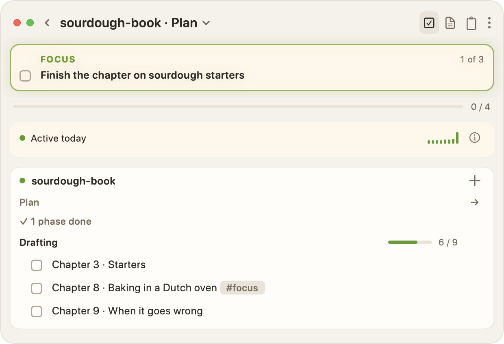

#focus

I have, yet again, revived WarpedVisions. It's been my blog since the 90s, when it was more of a Kottke-style link log. It still lives on Dreamhost, except for a few stints on hosted blog tools. But this post isn't about that; it's about me rediscovering who I am. I am a writer. I make software. And I love text, playing with words, and transforming them both into magical things.

I looked back at what I've built and written since spring: [a cookbook](https://bruce-loves-to-cook.ca/), a scorekeeping app, a pile of Obsidian plugins, a summer game jam, a weather tool, a text adventure engine. Different shapes, same handful of beliefs underneath. This is my attempt to write those beliefs down, mostly so I can check my next project against them.

## Plain text is the foundation

Almost everything I make starts, and ends up, as Markdown. Designs, specifications, recipes, tasks, blog posts, game briefs, comics, and even interactive fiction. Markdown is plain text: no API, no auth, no special SDK. It opens in any editor, it diffs in git, and it'll still be readable long after today's tools are gone.

- The not-a-chef (now [bruce-loves-to-cook](https://bruce-loves-to-cook.ca/)) rule transformed my cookbook and recipe development: *"A recipe should look natural in any text editor."* Pages have to read as plain text, render in Obsidian and Hugo, and still be [parseable by tools](/blog/2026/not-a-chef/smart-content-on-plain-markdown/). It's fast, easy, and it gets out of my way.
- [Space Command](https://space-command.ca/) is a macOS app that finds and manages `PLAN.md` files, via `#todo`, `#idea`, and `#focus` tags straight out of my notes. The source of truth is my source and my text files, and not something else.
- [Thwarter](https://github.com/robotpony/thwarter), my interactive fiction engine, builds stories from Markdown and front matter, the same way Hugo builds a site.
- And all of my blogs, comics, and repos live in text. It is the only truly durable format.

Here's part of a plan from Space Command's demo world, a sourdough book in progress, as text and as the app shows it:



```markdown
## Drafting

- [x] Chapter 1 · Flour
- [x] Chapter 2 · Water and salt
- [ ] Chapter 3 · Starters
- [x] Chapter 4 · Mixing and folding
- [x] Chapter 5 · The first rise
- [x] Chapter 6 · Shaping
- [x] Chapter 7 · Proofing in the fridge
- [ ] Chapter 8 · Baking in a Dutch oven #focus
- [ ] Chapter 9 · When it goes wrong
```






That's the whole format. Every checkbox in a `PLAN.md` is already a task, so it needs no tag, and `#focus` marks the chapter I'm on now. In any other note, a `#todo` at the end of a line does the same job. It reads fine in `vim`, renders in Obsidian and on GitHub, and Space Command folds the finished work away so only what's left shows, `#focus` tag and all.

```timeline
1983 Atari BASIC
1994 *The UNIX Philosophy*
1996 Carmack's `.plan` files
2002 Blosxom
~2008 WordPress, a detour
~2015 Hugo, first look
2022 Hugo
```

My love of text started a long time ago, but the real inspiration was [John Carmack's `.plan` files](https://github.com/oliverbenns/john-carmack-plan). Around that time I read Mike Gancarz's [*The UNIX Philosophy*](https://www.goodreads.com/en/book/show/633070.The_UNIX_Philosophy), which cemented the principles. I was already working in text, but these set the foundation in my mind. The idea that text could define everything, including raw design thinking, was revolutionary to me. I learned that text is raw power.

I even learned `vim` at the time, something I've never regretted. It's as outdated now as it was then, but it really leans on what text does well. I learned to stack piped commands and to write scripts in *Perl*, *Python*, and *Ruby*. Ruby at the time was a toy, well before it powered Web 2.0, but it felt text-y to me.

I also encountered a number of text-y tools at the time, including [Blosxom](http://www.blosxom.com/), the first truly great blogging tool. Sure, there were Blogger and Movable Type, but owning your content in a format you can search and script was something I knew was special.

Finally, text is incremental, especially when paired with source control. Other tools have undo and history, but they're buried in menus, while `git log` and `diff` are one command away. And the commands are richer: you can see the reasons for changes, tag and branch to show progression, and remix easily. You never really lose changes. Yes, I realize the terminal is not great for all users, but for me it's home.

## Writing is how I think

My first real computer was an Atari 600XL. I usually tell people it was an 800XL, which I got a few years later, so I don't have to explain the difference. With the 600XL I got a whopping 16 KB and a previous-generation tape drive, the bane of my childhood. The drive ate tapes, often the low-quality ones I could afford at 10 years old from Radio Shack, so I saved each game I wrote several times, wrote down its design, and sketched out its interfaces, down to the bit for custom fonts and sprites.

That tape drive ate every copy of everything I wrote, so I reimplemented most games several times. I wrote dozens, all of them lost to time. The notebook survived when the tape didn't, and somewhere along the way the notes stopped being a backup and became how I figure out what to build. I use the same pattern now, except that source control has replaced the extra copies. I always write down the design, and I always mock up user and programmatic interfaces.

CLAUDE.md files are that notebook again. An AI tool forgets everything between sessions, the way the tape forgot my games, so I write the design down first and it rebuilds from there. It's the same lesson, about 40 years later.

I've written more about [the fight for clarity and beauty in writing](/blog/2015/the-fight-for-clarity-and-beauty-in-writing/) and about [how a tireless robot editor rekindled my love of writing](/blog/2025/how-i-rekindled-my-love-of-writing-with-a-tireless-robot-editor/). The whole tape drive story is on my [working with me](/pages/working-with-me-bruce-alderson/) page.

## Show the work

The usual way to write a cookbook is to hide the work. Being me, I'd rather not hide the design and development of recipes. The bruce-loves-to-cook recipes that aren't finished are marked [**Test kitchen**](https://bruce-loves-to-cook.ca/reference/essays/test-kitchen/), and they're published on purpose. A recipe is closer to source code than scripture: it has versions, bugs, and fixes.

- Game jam rule 4: post your updates online weekly, including specs, and prompts if used.
- Repos carry their plans, bug lists, and decision logs in the open.
- Working with AI is part of the work, so the prompts and CLAUDE.md files get shown too.

Research is showing the work before it's finished. I try several, compare honestly, and write down why: [batches of recipes side by side](https://bruce-loves-to-cook.ca/essays/technique-essays/how-to-find-great-recipes/) to find the best one, notes on Environment Canada's feeds for [dailyweather](https://github.com/robotpony/dailyweather), and four looks for Scorekeep before choosing one.

Showing the work keeps me accountable. The game jam's weekly posts meant there was always something to show, so I kept shipping.

## Teach by writing it down

I like to say that *"I love to teach, I think."* Sometimes I'm uncertain, because I'm also impatient, and it's easy to forget how I got to understanding something. You need to remember your path to describe a path to people learning, and those darned paths change with each generation of tools and humans. But I do like to teach, I think.

I remember helping a number of people learn SQL. SQL is a powerfully dense and obscure language for asking questions about structured data. It's incredibly efficient when used properly, which requires some math-y thinking, some background, and a bunch of experience. I've always struggled to teach this to beginners. I suspect I've never thought deeply about, or developed a clear plan for, teaching them. Teaching it live, I'd forgotten my own path; writing it down is how I find it again.

My way of teaching is to write. I can write and be frustrated, and not influence anyone negatively. I just put that frustration into my writing and redraft. Once written, I can teach effectively, but those lesson plans are where the real effort is. Well, that and keeping those lesson plans up to date where they fall short.

The recipes are where this works best. I didn't start to grok cooking until I realized the methods were key. The French figured this out forever ago, and of course I had to rediscover it through chefs like [Kenji](https://kenjilopezalt.com/) and [Chef John](https://www.foodwishes.com/). Showing methods teaches people how to adapt, as recipes can rarely be exact. Ingredients differ, conditions like humidity differ, as do equipment, dietary needs, and so on.

As my recipe-maker notes put it, teaching people to cook, and making it easier to do it well, "is a way to make a difference for many people."

## Own the press

This site has been running for close to 30 years, on more engines than I can list (see [about the site](/pages/about-warpedvisions-dot-org/)). It's always been my testing ground. Today it's Hugo, my own theme, a few scripts, and rsync to the same host I've used for decades.

```flow
Markdown | in git
Hugo
public/
rsync
Dreamhost
```

- The site [has no comments](/pages/about-warpedvisions-dot-org/), on purpose: if you want to respond, write something of your own.

I built a few versions of Blosxom myself, too, once it was no longer maintained. My versions were pale imitations of it, but then I found [*Hugo*](https://gohugo.io/). Hugo is fast. It lives on Markdown. It extends and themes easily, and it was so much better than *WordPress*.

The pipeline really matters to me. I was very proficient with WordPress from my agency days, but I never found a productive writing flow for it. I was always fighting the web UI. I couldn't `grep` it, and I couldn't see it locally without a lot of setup. That opaqueness runs against the grain of how I think.

I learned this again on [Write.as](https://write.as). In 2022 I [moved the site there](/blog/2022/warped-v40/), which meant hand-importing 60 posts over about 10 hours of evenings and cleaning up the Markdown that 17 generations of WordPress and Pandoc left behind. In 2024 I [ported it back to Hugo](/blog/2024/warped-42-back-to-basics/) in about a day, and since then it's lived as plain text in a repo I own. That's the IndieWeb idea of [POSSE](https://indieweb.org/POSSE): publish on your own site first, and syndicate elsewhere.

## Make it fun

From my game-making principles: be emotive, be funny, be fun. Lean into constraints, limits, and plot holes.

- [The summer game jam](https://github.com/robotpony/game-jams): four weeks [rebuilding games](/blog/2025/the-feels-of-nostalgia-can-drive-great-design/) I played and wrote between 1980 and 1985, on [PICO-8](/blog/2022/playing-with-the-pico-8-fantasy-console/), Picotron, TIC-80, and pygame.
- [Retro desktop demos](https://github.com/robotpony/retro-demos), LED displays, a CD player nobody needs.
- Scorekeep's goal: "it should feel like what it is: paper." Buttery smooth over feature-complete.
- "Things that teach. Things that make you smile."

Fun also needs [feeding the muse](/blog/2025/burnout-is-a-repetitive-strain-injury/#feeding-the-muse), and scrolling rarely does it. Feeds are built to farm [fake internet points](/blog/2025/the-addictive-math-of-fake-internet-points/).

## Craft, inch by inch

I believe simplicity is possible in anything, where simple means things fit _just so_. It's [a kitchen I know by heart](/blog/2025/the-comfort-of-home-bases-for-creative-work/), where I stop thinking about the tools and think about the food.

Who we are is had inch by inch, failure by failure, and craft works the same way. It's fit and finish, done in small steps: a recipe that stays in the test kitchen until it earns its way out, a heading nudged closer to the paragraph it belongs to, a commit that does one thing. Text makes those steps cheap, and git keeps every one of them, so I can afford to fail a lot on the way to _just so_.

## What this means for what's next

The 10-year-old with a notebook beside a tape drive and the person writing CLAUDE.md files are doing the same thing. Both write the design down first, because the machine will forget it. Both keep the notes somewhere they can be read and rebuilt from. I didn't set out to work this way; I only noticed it looking back over this year.

So what's next is more of the same, on purpose. [Space Command](/blog/space-command/) is in alpha playtest now, and it's the most direct version of all this: an app whose source of truth is plain text I've already written. I'll keep writing about it here first. If any of it sparks something for you, write about it on your own site and link back.

<!--
More links to consider:
- /pages/about-bruce-alderson/
-->
