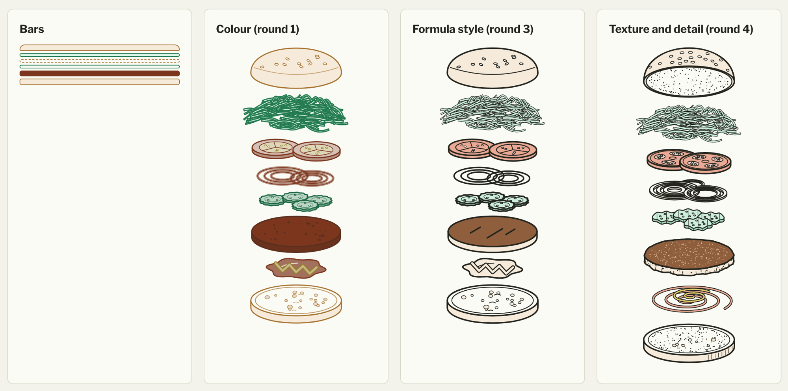
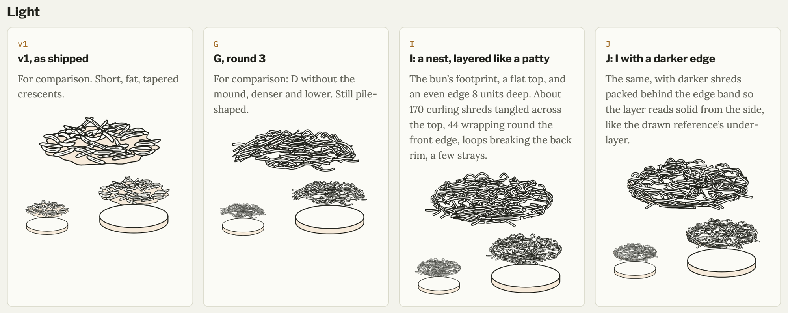
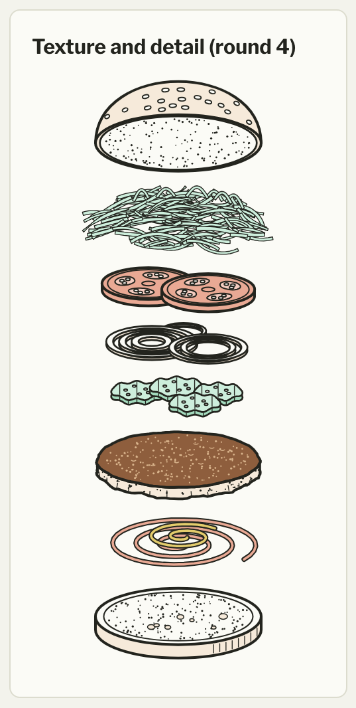
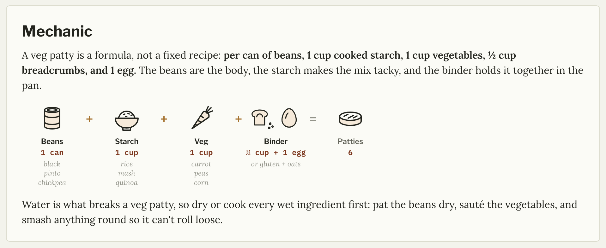

<!--
PASS 1 DRAFT. Post 1 of 5 in the Not a Chef series. List post, target 1500-2000 words.
Core argument: the agents could always write the code. Most of the cost came from deciding, verifying and drawing, and the habits that held were the ones written down as files, mocks or hooks.

Headline options:
1. Ten things I learned building a cookbook with agents
2. What 554 commits taught me about building with agents
3. Building a family cookbook with Claude Code: ten lessons
4. The cookbook took three weeks; the drawings took longest

Changes this pass:
- Scope creep is now #10, and "make interaction the point" folds into it and the intro. That keeps the list at ten. Say if you'd rather have eleven.
- Reader quotes are unattributed.
- Facts come from the not-a-chef git log and agent (teardowns, lettuce, food safety, handoff, scope-creep share). Still open: the blocked batch import (nothing on record), the token figure (repo has only "under a month of Pro tokens"), and the public name.

Open: [AUTHOR DECISION] "Not a Chef" vs "Bruce loves to cook" as the public name. This draft uses "Not a Chef" for the project and links the site.
-->

I spent the last few months building [Not a Chef](https://bruce-loves-to-cook.ca/), our family cookbook, with Claude Code. It's a Hugo site, edited in Obsidian, with 223 recipes, 17 essays, 28 method pages, 14 reference pages and 39 engineering-style food log pages.

The notes from readers have been the best part:

> *It makes me want to click things, which is the opposite of most recipe sites I visit.*

> *Win the fridge! I learned that phrase from you and use it all the time.*

> *"Garbage plates" got a much-needed laugh out of me at 5:30pm on a Monday evening.*

Readers don't see the 554 commits behind it. I scaffolded it in early June, then spent a slow summer migrating recipes. The real build took about four weeks this fall, ending in what I'm calling *build 1*. The busiest day had 79 commits.

Why bother? The Google Docs cookbook was good enough for years, but it was never going to be smart, and it never read as a website to my kids. I wanted the structure a document can't give you, and something that belonged on the internet.

I kept commits small and wrote the *why* into each message, so the log reads back like a diary. That's where most of this list came from, and the posts linked at the end go deeper.

## 1. Design first, and keep the mocks as the decision log

Before writing any theme code, I ran four rounds of mockups and boiled them down into a style guide, `STYLE.md`, on the first day of the real build. It held the site together through weeks of churn.

That went beyond visual design. I formed strong opinions early about approach, how the code would split into modules, and which agent did what, and then adjusted them as the workflow showed me where they rubbed. A plan that firm made the project cheap: about 1/64th of a month of tokens. 

The mocks became the decision log. There are 32 of them, each an HTML page showing options side by side, in light and dark, with real recipe data. When I picked one, a dated *Decided* line went into the mockups README and the style guide, and the mock stayed as the record.

A decision written into a file survives across sessions and agents. A decision made in chat doesn't. This applies doubly to humans.

## 2. Mock to decide, because building to decide is expensive

Some features got built, lived on the site, and then came out:

- **Card popovers** went in early and came off the cards two weeks later. Moving the mouse across a grid of cards popped them up and pulled the eye off the page. Each chip already linked to its explanation, so the chips became plain links. Popovers survive on glossary terms in prose. I hated myself for posting this.
- **The definition callout** shipped the same day, was generalized to every kind of concept a couple of weeks later, and was retired two days after that. Next to a sidebar, it was one box too many.
- **The builds rail** on the methods list was built and replaced by cards within a few hours. The next day the builds left the list entirely. The rule we wrote down: the list is the map, and the blueprint page is the shelf.
- **Three burger recipes** (Big Boy, double smash and Whopper) were added and then dropped a few days later, once the burger builds covered them.

Each of those cost a build, a review, a removal and a doc cleanup. A mock costs an afternoon, and throwing one away costs nothing.

## 3. Verify side by side, not piece by piece

The first theme pass checked out rule by rule. Every CSS property matched the style guide, yet the page background was white everywhere, because the base theme hardcodes it. The agent's own verdict was "maybe 50% there", which I rejected, and asked for the mock and the real site side by side. That found the problem in a couple of minutes.

The other version of this was sneakier. This Mac's default browser is Safari, and the browser automation can't see into it. For a while a whole "verified" pass checked a window nobody was looking at, called it done and moved on.

A clean build and a matching grep are different facts from "it looks right". Only looking proves the last one.

## 4. Pictures cost one to two orders of magnitude more than text

My rule of thumb now: pictures are one to two orders of magnitude more work than text. The recipe sidebar was prototyped and settled in a single day early in the build. Shredded lettuce took four rounds, and this is after using a single icons for all forms of lettuce.

It got its own layer in the burger drawings near the end of the build, and it kept reading as bananas at card size. Two days later we redrew it from my reference photos: three options first, then a lumpy mound with strands down its slopes, then a bird's nest layered like a patty. *Option G*, dense curling strands in a low pile, finally shipped, and a last commit lightened it so the shreds weren't darker than the pickles beside them.

The agents drew, suggested and iterated, and the suggestions were often good. The vision and the tuning were mine, and that's where most of the calendar went. It gets its own post: [Drawing with text, and why the pictures took longest](/blog/2026/not-a-chef/drawing-with-text-and-why-the-pictures-took-longest/).

## 5. Hooks enforce, memory guides

Claude Code's memory was great for habits and principles: open mocks in Chrome, check the style guide before mocking, write commit messages a certain way. A correction given once held for the rest of the project.

It wasn't enough for rules that must never break. A system-level instruction added an AI co-author trailer to three commits before I caught it, and fixing that meant a rebase and a force-push. The commit and push rules moved into repo hooks after that, and they haven't slipped since.

The split is simple. Anything that must never break goes in a hook; taste and judgement go in memory. Discipline loses to enforcement eventually, and that's as true for people as it is for agents. [Working with agents on a real content project](/blog/2026/not-a-chef/working-with-agents-on-a-cookbook/) covers how they were set up.

## 6. A base theme is scaffolding you rent

[Blowfish](https://blowfish.page/) gave me a working site on day one, with search, dark mode, RSS and SEO already done. Then I spent about a day fighting it: a hardcoded body background, no hook for fonts, no mega-menu, and a colour model that didn't match mine.

The worst of it was silent. The dark mode toggle used `dark:hidden` on one icon and `dark:inline` on the other, the build was clean, and in dark mode the button collapsed to an empty box. Blowfish ships precompiled Tailwind, so a class only exists if the theme already uses it somewhere. `dark:hidden` did. `dark:inline` didn't.

After that day it faded into a base layer: I override 17 of its 141 templates. The site could leave it cheaply. The real decision came about three weeks in, when I split the cookbook parts into [Fugu](https://github.com/robotpony/hugo-theme-fugu), a reusable theme that depends on Blowfish.

## 7. Don't plan too far ahead

The phased plan had a Phase 9: a spec validator, ingredient parsing, price and department data, and a JavaScript layer. Almost none of it exists, and I don't miss it.

Other planned work went stale before I got to it. A client-side script for wiki links became pointless once a Hugo render hook handled them. A batch import was blocked because its source folder had been deleted first. 

I'd plan the next phase in detail and the rest in a sentence each.

## 8. Review content like code

I ran review passes over the recipes the way I'd review a pull request, tracked in a `REVIEW.md` checklist that any session could pick up at the first unchecked box. They found more than style problems. A fajita chicken bowl said to cook to 62°C (144°F) and rest to 65°C; it now says 68°C (154°F) at the centre, with a 74°C (165°F) option for vulnerable guests. Roast chicken breasts pulled at 63°C moved up. A char siu marinade that had touched raw pork now gets boiled before it becomes a glaze. Another pass fixed storage and reheating in five recipes, from how long fresh salsa keeps to reheating a casserole to 74°C.

The fixes went into the source, not the templates. Garbled migrated recipes were rebuilt into the proper format, and old link styles were converted. Templates that paper over bad content just hide it for later. The format gets its own post, [Smart content on plain markdown](/blog/2026/not-a-chef/smart-content-on-plain-markdown/).

## 9. Split agents by role

The site, the Fugu theme and the content each had their own agent, and each agent owned its part of the repo. It worked well and probably saved tokens, since no session carried the context of all three.

The rough edges were handoffs and setup. Reconfiguring an agent's role was fiddly, and a few handoffs were untidy. The site agent wrote an intro for the burger builds and waited for Fugu to show it. Fugu read it from a `lead.md` file, the site updated to match, and then Fugu switched to reading `_index.md`, so the site had to move the file. That's three commits across two repos to place one paragraph.

I pulled the theme out only once its boundary was obvious, about three weeks into the build. Splitting it earlier would have meant guessing where the boundary was.

## 10. Let some scope creep in, on purpose

The burger blueprints are scope creep, and I knew it at the time. They grew a whole structure of methods, blueprints, parts and builds, each burger drawn as an exploded stack of layers, with a lineage timeline showing where each build came from. Roughly three quarters of the commits in the last five days of the build touched them.

Some of that was gratification. I wanted to see my burgers drawn, and that's a bit narcissistic. It was also a test of whether plain markdown could carry deeper learning material. The bar we set for a method page: after reading it, could you cook something that isn't written down anywhere on the site? That means explaining why each step is there and how it fails, not just listing the steps.

They turned out to be the best example of show-don't-tell on the site. The interactive parts (checkboxes, scaling, metric and imperial, the formula strips and blueprints) are why readers want to click things.

## Who it left behind

Sharing the cookbook got far easier. Editing it got harder. Hugo, Obsidian and git are nerdy coder tools, and my wife still finds the old Google Drive cookbook easier to edit. She keeps adding recipes there, and I move them over.

So it's a better cookbook for the people reading it and a worse one for one of its two authors. That trade-off is the subject of [Should you build a cookbook this way?](/blog/2026/not-a-chef/should-you-build-a-cookbook-this-way/)

Next in the series:

- [Working with agents on a real content project](/blog/2026/not-a-chef/working-with-agents-on-a-cookbook/)
- [Smart content on plain markdown](/blog/2026/not-a-chef/smart-content-on-plain-markdown/)
- [Drawing with text, and why the pictures took longest](/blog/2026/not-a-chef/drawing-with-text-and-why-the-pictures-took-longest/)
- [Should you build a cookbook this way?](/blog/2026/not-a-chef/should-you-build-a-cookbook-this-way/)
