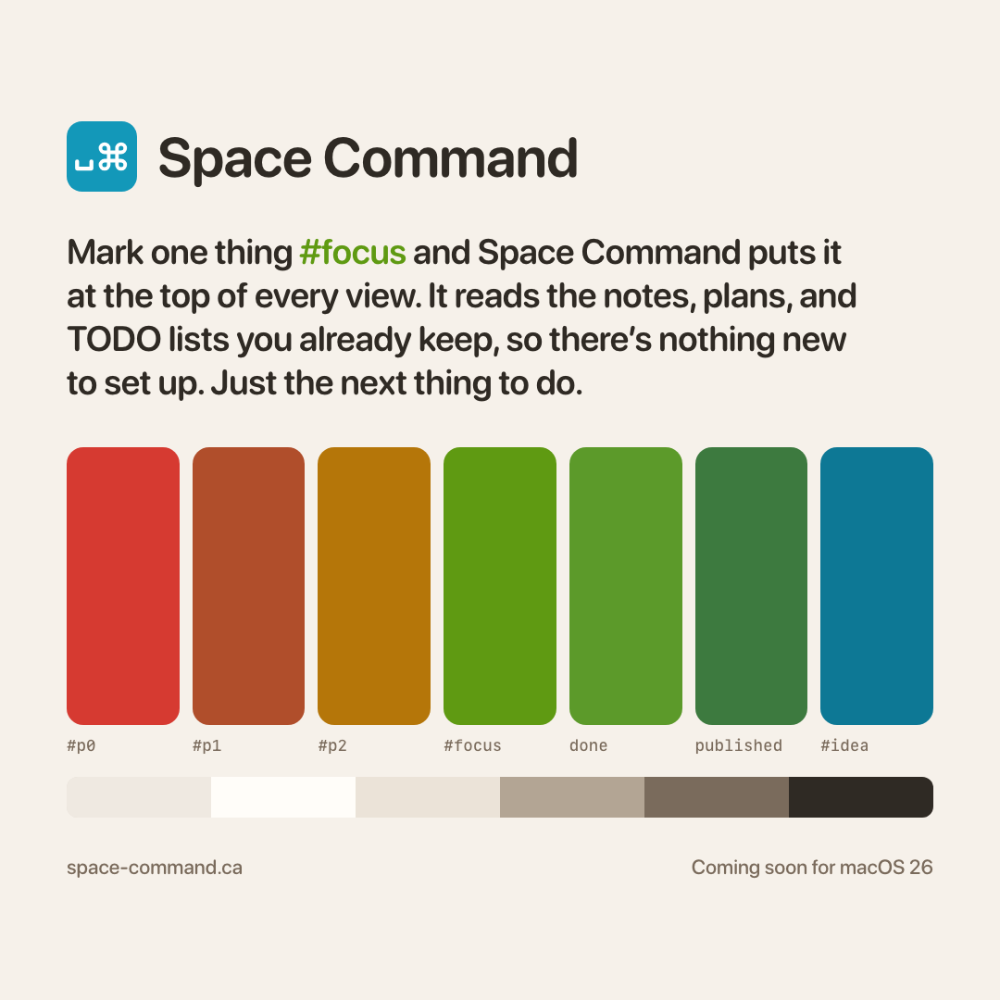

The first teaser for Space Command, the Mac sidebar I'm building for the plans and TODOs I already keep in plain text.

It's pre-alpha, so there's nothing to download yet, but the palette's settled and `#focus` leads every view. More at [space-command.ca](https://space-command.ca/), or in the [introduction](/blog/space-command/space-command-a-mac-sidebar-for-plain-text-projects/).
