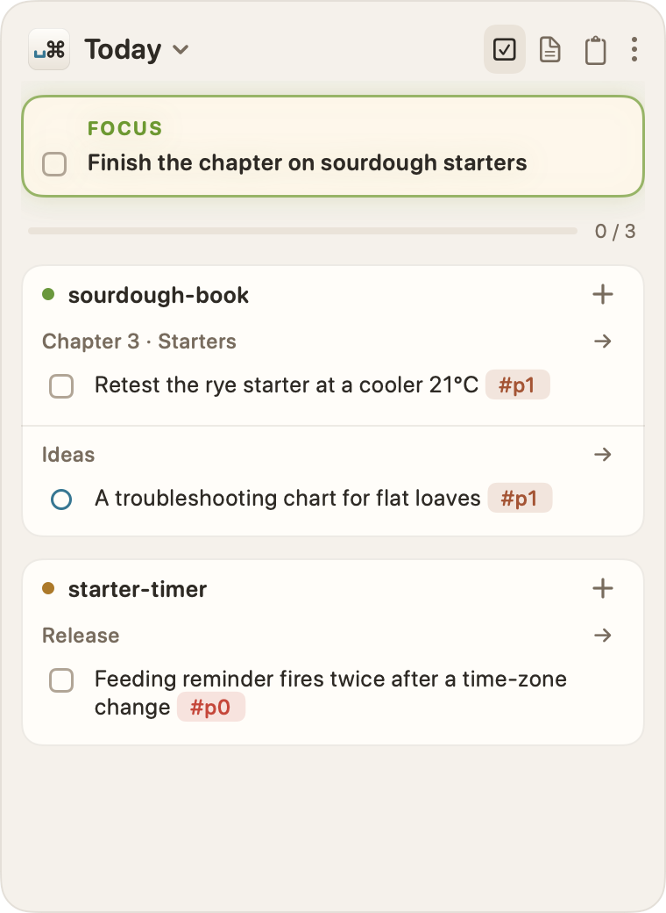
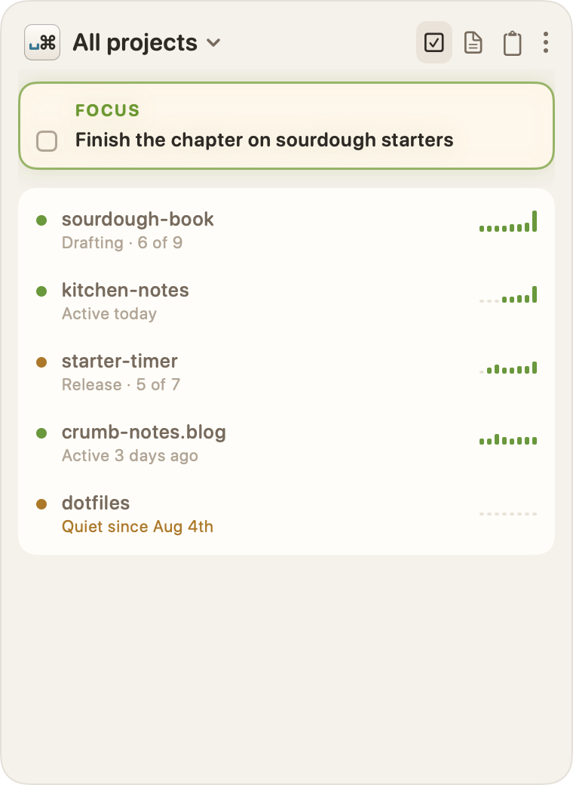
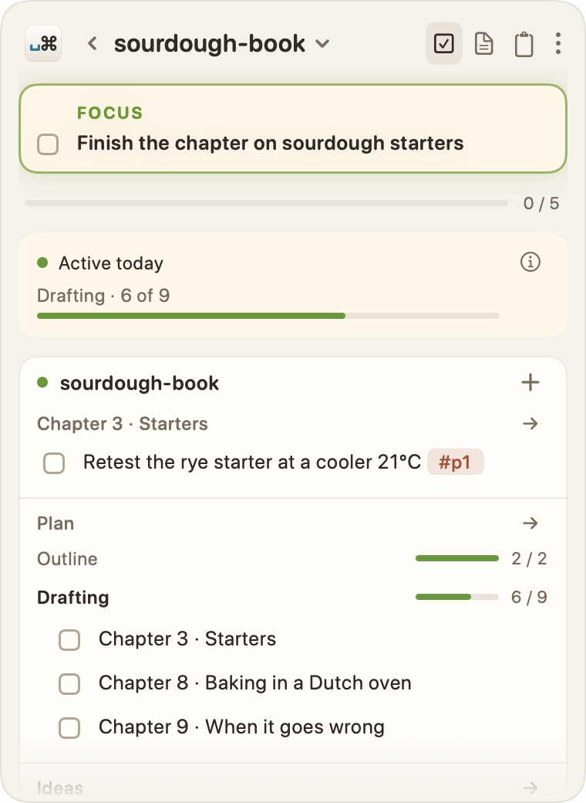
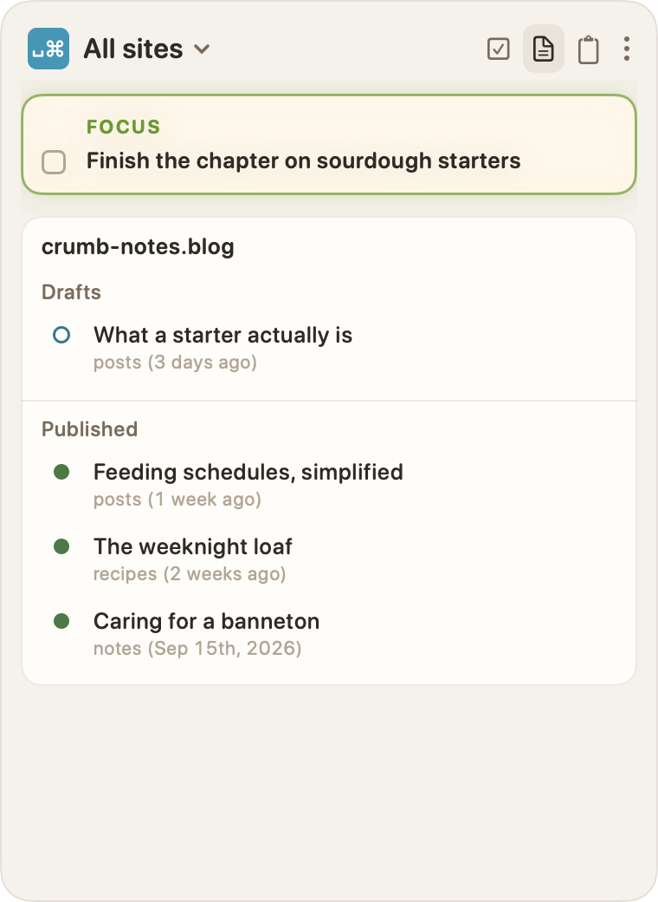
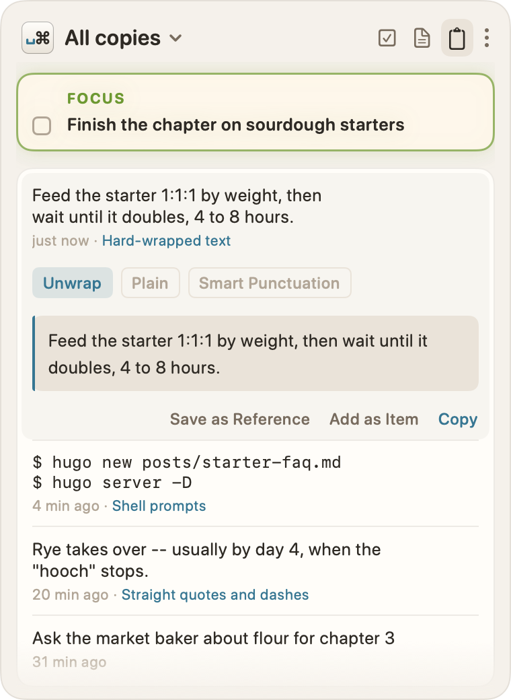

 is in playtest. It's the Mac app that grew out of warped-command, my Obsidian plugin, but it works across all my folders instead of one vault. It reads the plans, TODOs, ideas, and posts I keep in plain text and shows me the one thing to do next.

The alpha is running on my own repos, vaults, and Hugo sites now, and I'm finding the rough edges. There's no public download yet, and it needs macOS 26.

## A tour in five panels

It lives in the menu bar and opens as a sidebar with three tabs: Tasks, Posts, and Clipboard. These shots come from a made-up demo world, so the projects are invented, but the panels are real.





## How it works

The [help docs](https://space-command.ca/help/) are up for anyone curious. They cover setup, tasks and ideas, projects and their health, posts, the clipboard, key commands, and a few tips. The teaser site is at [space-command.ca](https://space-command.ca/), and the [introduction](/blog/space-command/space-command-a-mac-sidebar-for-plain-text-projects/) has the backstory.
